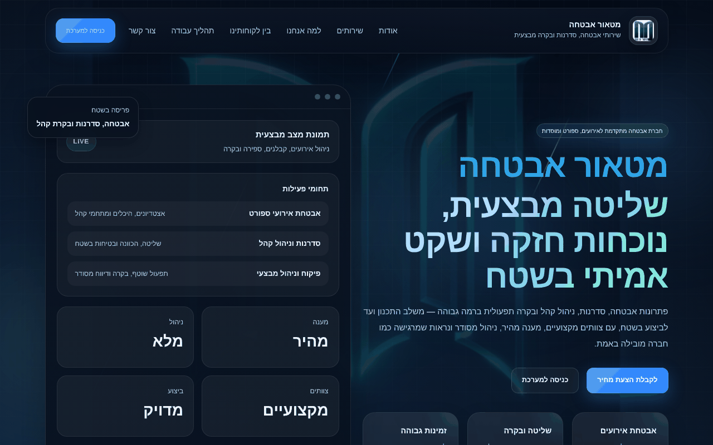
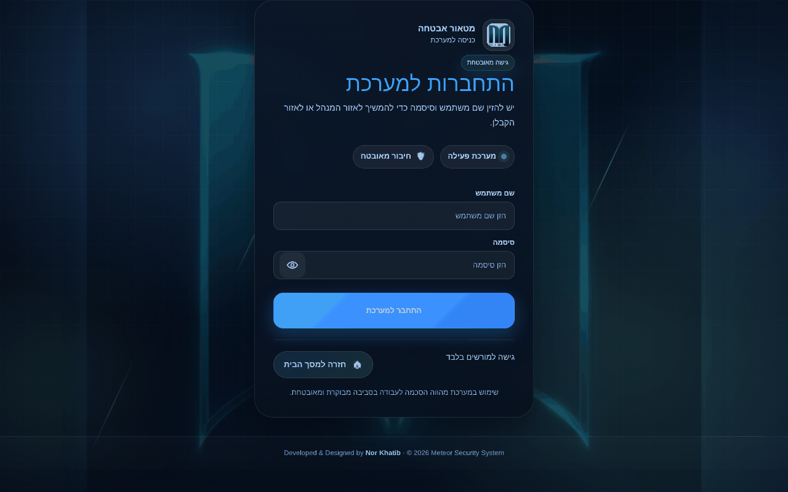
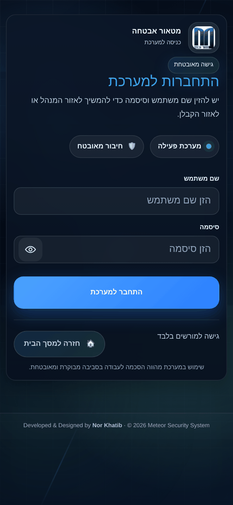

# Meteor Security – Event Staffing System

Website + operations system for a security & event staffing company: public marketing site, event management, contractor assignment and live head-count in the field. Hebrew RTL.

## Screenshots

| Desktop | Mobile |
|---|---|
| **Home**  |  |
| **Login**  |  |

## Modules
- **Public site** – services, about, contact (`index.html`).
- **Events** – create and manage events, sites and required staffing.
- **Contractor assignment** – assign staffing contractors to events, with state tracking.
- **Field counting** – real-time count of guards actually present vs. ordered.
- **Contractor portal** – each contractor sees their events and staff.
- **Contractor management & admin view** – manage contractors and review their activity.
- **System tables** – lookup data management.
- Role-based login (admin / contractor).

## Tech stack
HTML · CSS · Bootstrap 5 · Vanilla JavaScript · Supabase (Auth, Postgres, RLS)

## Run
Static site — serve with any static server or deploy to Netlify. Supabase settings are in `js/config.js` (publishable/anon key only).
